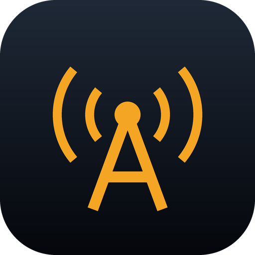
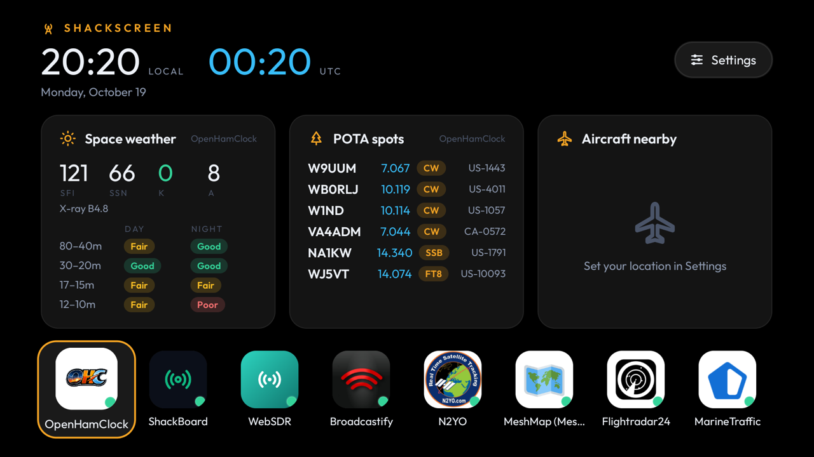
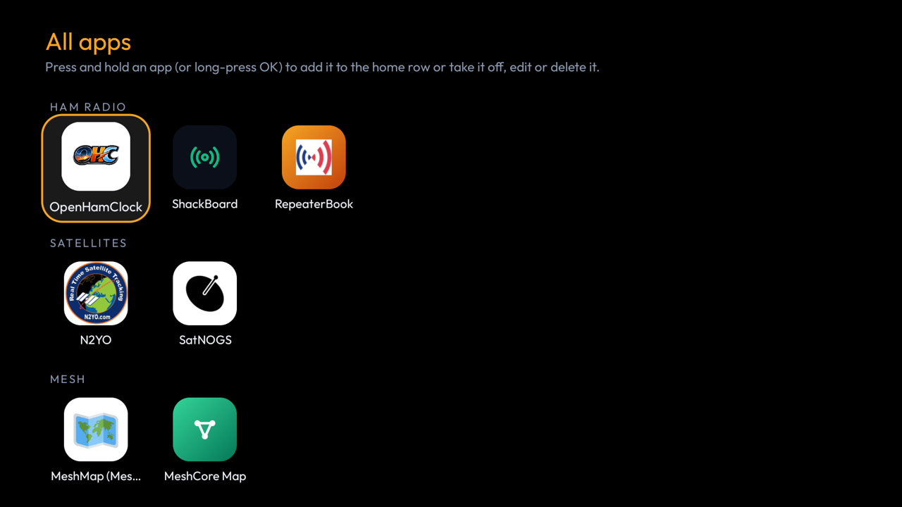
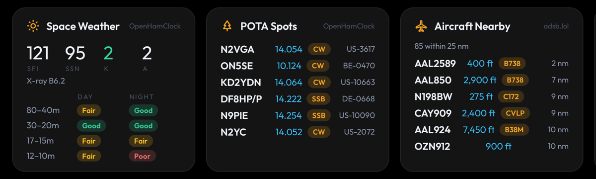
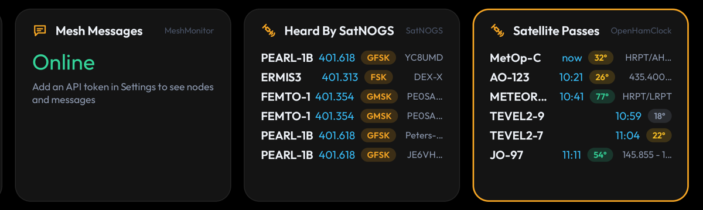
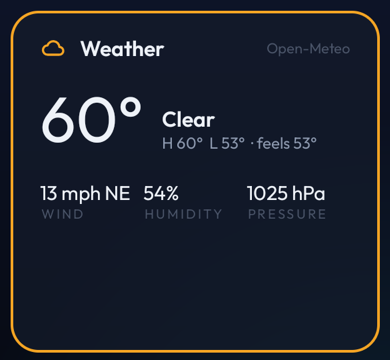
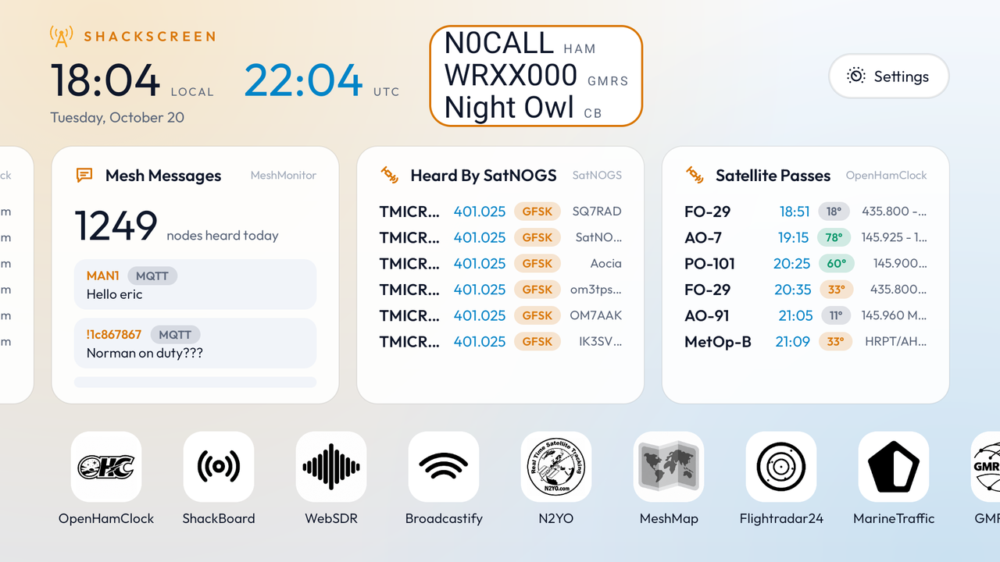
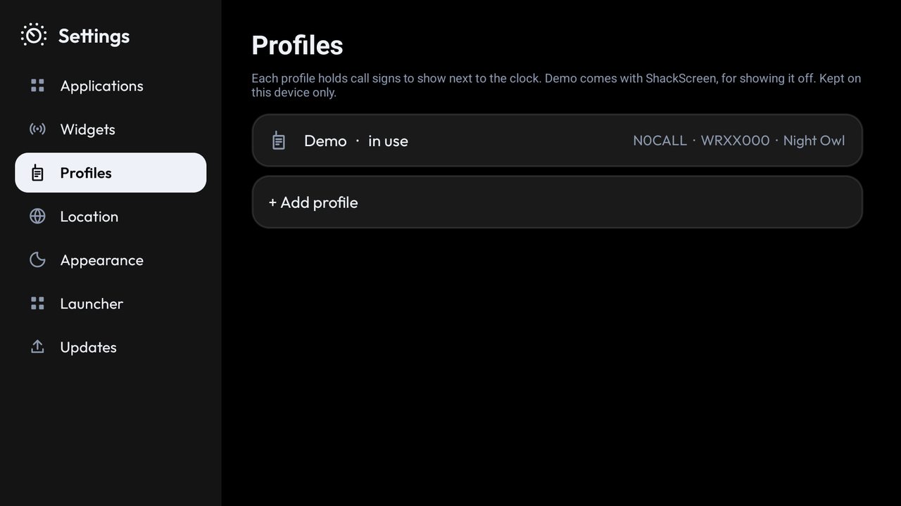

<p align="center">
  
</p>

<p align="center">
  <a href="../../releases/latest">
    
  </a>
  <a href="https://developer.android.com/tv">
    
  </a>
  <a href="https://developer.android.com/large-screens">
    
  </a>
  <a href="https://opensource.org/licenses/MIT">
    
  </a>
</p>

# ShackScreen

**ShackScreen** is a free **launcher dashboard** for Android (Android TV, Google TV, Fire TV and Android tablets) that turns the TV or tablet in your shack into a live radio dashboard, for people who love frequencies: hams, LoRa Mesh (Meshtastic and MeshCore) users, satellite chasers, and ADS-B and AIS listeners.

Live **widgets** across the top: space weather, POTA and DX spots, satellite passes, mesh messages, aircraft and ships nearby, and the weather. Your radio web applications along the bottom: [OpenHamClock](https://github.com/accius/openhamclock), [ShackBoard](https://shackboard.com), [MeshMonitor](https://github.com/Yeraze/meshmonitor), [WebSDR](http://websdr.org), [Broadcastify](https://www.broadcastify.com), [Flightradar24](https://www.flightradar24.com) and more, full-screen with the remote.

---

## Screenshots

**Home**: the clock and your call signs, widgets in the middle, your applications along the bottom



**All applications**: categories with counts down the side



**Widgets**: Space Weather, POTA Spots, Aircraft Nearby



**Widgets**: Mesh Messages, Heard By SatNOGS, Satellite Passes



**Widget**: Weather



**Light theme**



**Settings**: location, theme and updates




---

## Quick Start (5-minute setup)

### 1) Download

Get `ShackScreen-<version>.apk` from [**Releases**](../../releases/latest).

---

### 2) Install it on the TV

- **Fire TV:** install the free *Downloader* app, allow it to install unknown apps, and open the APK's link.
- **Android TV / Google TV:** copy the APK with a file-transfer app (e.g. *Send files to TV*) and open it, or from a computer:

```sh
adb connect <tv-ip>
adb install ShackScreen-<version>.apk
```

---

### 3) Open ShackScreen

Space weather and POTA spots show up straight away, from the public OpenHamClock.

---

### 4) Set your location

**Settings → Location → Pick on a map**: the arrows move the map under the crosshair and **OK** sets it. **Menu** zooms, finds a place by name, or changes the map style. On a tablet, drag and tap. Or type a grid square (`FN31pr`) or latitude, longitude (`40.7, -74.0`).  
Needed for Aircraft Nearby, Satellite Passes and Weather.

**Map styles**: Dark (default), OpenStreetMap, Streets, OpenTopoMap, Humanitarian and Satellite, all free. You can also use **your own API key** for CARTO, Google Maps (Map Tiles API), Mapbox, MapTiler, Thunderforest or Stadia Maps (**Add a map with your API key**), or any tile server by its `{z}/{x}/{y}` address (**Add a custom map**). Keys are encrypted and stay on the device.

---

### 5) Add your call signs (optional)

Select your call signs next to the clock (or **Settings → Call Signs**) and add your **ham call sign**, **GMRS call sign** and **CB handle**. They show next to the clock, and stay on the device.

---

### 6) Add your own servers (optional)

**All applications → Add app**: pick an app, then **My own server** and type its IP. The default port is added for you.

---

## Widgets

Pick them in **Settings → Widgets**. Press and hold a widget to **move** or **remove** it; select it to open the app its data comes from. Three fit across a TV, two on a portrait tablet, one on a phone. When nobody touches the remote for a minute, the dashboard pages through the rest on its own.

### Ham radio

| Widget | Data from |
|---|---|
| Space weather: SFI, sunspots, K and A index, X-ray, HF band conditions | [OpenHamClock](https://github.com/accius/openhamclock) or [ShackBoard](https://shackboard.com) |
| POTA spots | [OpenHamClock](https://github.com/accius/openhamclock) or [ShackBoard](https://shackboard.com) |
| DX cluster spots | [OpenHamClock](https://github.com/accius/openhamclock) |
| Contests, on now and coming up | [OpenHamClock](https://github.com/accius/openhamclock) |
| DXpeditions on the air | [OpenHamClock](https://github.com/accius/openhamclock) |

### Satellites

| Widget | Data from |
|---|---|
| Satellite passes over you: time, max elevation, downlink | [OpenHamClock](https://github.com/accius/openhamclock)'s orbital data, predicted on the device |
| Satellites just heard, with frequency and mode | [SatNOGS](https://github.com/satnogs) |

### Mesh (via MeshMonitor)

| Widget | Data from |
|---|---|
| Mesh sources: Meshtastic, MeshCore, MQTT, connected or not | [MeshMonitor](https://github.com/Yeraze/meshmonitor) |
| Mesh nodes heard today | [MeshMonitor](https://github.com/Yeraze/meshmonitor) |
| Mesh messages | [MeshMonitor](https://github.com/Yeraze/meshmonitor) |

In MeshMonitor's settings, create an API token and paste it into the MeshMonitor app in ShackScreen. The token acts as your user, so it only sees what you can see.

### Aviation and marine

| Widget | Data from |
|---|---|
| Aircraft within 25 nm | **your own** [tar1090](https://github.com/wiedehopf/tar1090) / [readsb](https://github.com/wiedehopf/readsb) / [dump1090](https://github.com/flightaware/dump1090), or [ADSB.lol](https://github.com/adsblol), [adsb.fi](https://github.com/adsbfi) |
| Ships nearby | **your own** [AIS-catcher](https://github.com/jvde-github/AIS-catcher) |

### Local

| Widget | Data from |
|---|---|
| Weather | [Open-Meteo](https://github.com/open-meteo/open-meteo) |

Each widget uses the first of your applications that can supply it, and moves on to the next if a server is down.

---

## Applications

The home row holds your favourites, with **All applications** at the end. Press and hold an app (long-press OK on a remote) to move it, add it to the home row or take it off, edit it or delete it.

| Category | Applications |
|---|---|
| Ham radio | [OpenHamClock](https://github.com/accius/openhamclock), [ShackBoard](https://shackboard.com), [APRS.fi](https://aprs.fi), [PSKReporter](https://pskreporter.info), [RepeaterBook](https://www.repeaterbook.com) |
| GMRS | [GMRS Hub](https://gmrshub.com), [myGMRS](https://mygmrs.com) |
| Satellites | [N2YO](https://www.n2yo.com), [Heavens-Above](https://www.heavens-above.com), [AMSAT status](https://www.amsat.org/status/), [SatNOGS](https://github.com/satnogs), [TinyGS](https://github.com/tinygs/tinyGS), [Satellite map](https://satellitemap.space), [ISS Tracker](https://isstracker.pl/en) |
| Mesh | [MeshMonitor](https://github.com/Yeraze/meshmonitor), [MeshMap (Meshtastic)](https://github.com/brianshea2/meshmap.net), [MeshCore Map](https://github.com/meshcore-dev/map.meshcore.io), [your Meshtastic node](https://github.com/meshtastic/firmware) |
| SDR & scanners | [WebSDR](http://websdr.org), [KiwiSDR map](http://rx.linkfanel.net), [Broadcastify](https://www.broadcastify.com) |
| Aviation | [Flightradar24](https://www.flightradar24.com), [FlightAware](https://www.flightaware.com), [ADS-B Exchange](https://www.adsbexchange.com), [ADSB.lol](https://github.com/adsblol), [adsb.fi](https://github.com/adsbfi), [your tar1090](https://github.com/wiedehopf/tar1090) |
| Marine | [MarineTraffic](https://www.marinetraffic.com), [VesselFinder](https://www.vesselfinder.com), [MyShipTracking](https://www.myshiptracking.com), [your AIS-catcher](https://github.com/jvde-github/AIS-catcher) |
| Weather | [Windy](https://www.windy.com), [Lightning map](https://www.blitzortung.org) |
| Other | any web page |

### Pages inside an application

Some applications have several pages. **GMRS Hub** opens on its home page; **Menu** on the remote (or the **Pages** button on a tablet) switches to the Live Node Map, Hub Status, Groups and Get On GMRS Hub.

You can add your own pages to any application, such as more hub URLs or a hub status page for your own nodes: press and hold it, **Edit**, then **Your pages for this application**. To have a page as its own icon instead, add the application again with that address.

### Page size

Each application has its own page size, from 50% to 150%, so a site laid out large fits more on the TV. GMRS Hub starts at 80%. Change it with **Menu → Page size**, or in the application's settings.

### Saved logins

When you sign in to a site inside ShackScreen, it offers to save the login, like a password manager. Next time it fills it in and signs in for you.

- Saved **encrypted** (AES-256-GCM) with a key kept in the Android Keystore, which never leaves it. Nothing is sent anywhere.
- Filled in **only on the site it was saved for**.
- If a saved login doesn't work, ShackScreen fills it in but stops pressing the sign-in button, so a wrong password isn't sent over and over.
- Add, change or delete logins, or turn off signing in automatically: press and hold the application, **Edit**, then **Saved logins**.
- Needs Android 6 or later.

### Public site or your own server

- Applications you can also run yourself (**[OpenHamClock](https://github.com/accius/openhamclock), [WebSDR](http://websdr.org), [KiwiSDR](https://github.com/jks-prv/Beagle_SDR_GPS)**) ask **Public site or My own server** when you add them.
- **[MeshMonitor](https://github.com/Yeraze/meshmonitor), [tar1090](https://github.com/wiedehopf/tar1090), [AIS-catcher](https://github.com/jvde-github/AIS-catcher)** and a **[Meshtastic node](https://github.com/meshtastic/firmware)** are always your own server.
- Type just the IP and the default port is added. You can add the same app more than once (say, the public OpenHamClock and the one on your shack Pi).
- Addresses and tokens are stored **only on the device**.

### Remote access (VPN)

To reach servers at home from a TV somewhere else, use a VPN such as [Tailscale](https://github.com/tailscale/tailscale): no port forwarding, encrypted, works behind NAT.

### Missing an app?

**All applications → Request an app…** opens an [app request](../../issues/new?template=app_request.yml) here. On a TV, scan the QR code with your phone. The app list lives in [`catalog.json`](app/src/main/assets/catalog.json) and refreshes from this repo, so new applications arrive without a new APK.

---

## Themes and Icons

- **Settings → Appearance**: Black (default), Midnight, Ocean, Forest, Plum, Ember, Slate, Light, or follow the TV.
- Every application shows its **own icon**, fetched from the server you point it at and made square like a phone app icon. A site without a good one gets a coloured tile for its category.
- **Settings → Appearance → Application icons**: colour or black and white.
- ShackScreen's own icon set lives in [`icons/`](icons) (512 × 512 PNG, colour and black and white). The app loads it from this repo, so new icons arrive without an update. **Want to design one?** See [Contributing Icons](docs/ICONS.md).
- **All applications** lists them by category, with a count for each, like a TV channel guide.
- To change an icon: press and hold the application, **Edit**, then **Icon**. Choose a symbol, an image from a web address, or an image on the device (tablets and TVs with a file picker).
- Have a better icon for everyone? **Icon → Suggest a new icon on GitHub** opens an [icon request](../../issues/new?template=icon_request.yml); on a TV, scan the QR code with your phone.

---

## Remote and Touch

| | Remote | Touch |
|---|---|---|
| Open an app or widget | **OK** | tap |
| Choose what a widget opens | hold **OK** → **Opens** | press and hold → **Opens** |
| Move, remove, edit | hold **OK** | press and hold |
| Move a widget | arrows, then **OK** | on-screen arrows, then tap |
| Back a page / home | **Back** | back |
| Pages, page size, reload | **Menu** | Pages button |

An app that can't be reached is retried every 30 seconds, and the screen stays on while one is open.

---

## Updates

**Settings → Updates**:

- **Off** — never contacts GitHub
- **Tell me** (default) — checks GitHub Releases daily and shows an *Update* button
- **Install automatically** — downloads and installs new versions. Silent on Android 12+ once ShackScreen has updated itself once; one confirm click on older Android and Fire TV.

An update is installed only if it's ShackScreen, newer, and **signed with the same key**:

`a4b212f1b47635da599640c4c61d431b98671833b67f36b97df3a748ef5e8a32` (SHA-256)

---

## Requirements

- Android TV, Google TV or Fire TV with Android 5.1 or newer (or an Android tablet or phone)
- Internet
- Your own servers and SDR receivers: optional

No Google account.  
No root.  
No subscriptions.

---

## Build from Source

Needs JDK 17 and the Android SDK (platform 35). Turn on developer options and network debugging on the TV, then:

```sh
TV_HOST=192.168.1.50 ./build-and-install.sh
```

Without `TV_HOST` it only builds `app/build/outputs/apk/release/app-release.apk`.

---

## License

This project is licensed under the MIT License.

See the LICENSE file for details.  
Full license text: https://opensource.org/licenses/MIT

Includes the [Outfit](https://github.com/Outfitio/Outfit-Fonts) font (SIL Open Font License, included in the LICENSE file) and Project Nayuki's [QR Code generator](https://github.com/nayuki/QR-Code-generator) (MIT).

---

## Contributing

Pull requests are welcome. Open an issue first to discuss ideas or report bugs. See [CONTRIBUTING.md](CONTRIBUTING.md); adding an app to the menu is usually one entry in `catalog.json`.

---

## Acknowledgments

* Inspired by [CleanYourTV](https://github.com/Gathin23/cleanyourtv)
* [OpenHamClock](https://github.com/accius/openhamclock) by K0CJH
* [ShackBoard](https://shackboard.com)
* [MeshMonitor](https://github.com/Yeraze/meshmonitor) built by [Yeraze](https://github.com/Yeraze)
* [SatNOGS](https://github.com/satnogs) by the Libre Space Foundation
* [ADSB.lol](https://github.com/adsblol) and [adsb.fi](https://github.com/adsbfi) (ODbL)
* [AIS-catcher](https://github.com/jvde-github/AIS-catcher)
* [Open-Meteo](https://github.com/open-meteo/open-meteo)
