<p align="center">
  
</p>

<p align="center">
  <a href="../../releases/latest">
    
  </a>
  <a href="https://developer.android.com/tv">
    
  </a>
  <a href="https://developer.android.com/large-screens">
    
  </a>
  <a href="https://opensource.org/licenses/MIT">
    
  </a>
</p>

# ShackScreen

**ShackScreen** is a free **launcher dashboard** for Android (Android TV, Google TV, Fire TV and Android tablets) that turns the TV or tablet in your shack into a live radio dashboard, for people who love frequencies: hams, LoRa Mesh (Meshtastic and MeshCore) users, satellite chasers, and ADS-B and AIS listeners.

Live **widgets** across the top: space weather, POTA and DX spots, satellite passes, mesh messages, aircraft and ships nearby, and the weather. Your radio web applications along the bottom: [OpenHamClock](https://github.com/accius/openhamclock), [ShackBoard](https://shackboard.com), [MeshMonitor](https://github.com/Yeraze/meshmonitor), [WebSDR](http://websdr.org), [Broadcastify](https://www.broadcastify.com), [Flightradar24](https://www.flightradar24.com) and more, full-screen with the remote.

---

## Screenshots

All screenshots use the **Demo** profile that comes with every install, and each theme with the icon style suggested for it.

**Home**: Black theme, Colour icons. The clock and your call signs, widgets in the middle, your applications along the bottom


**All applications**: categories with counts down the side


**Widgets**: Aircraft Nearby, Weather (with the next five hours), DX Cluster

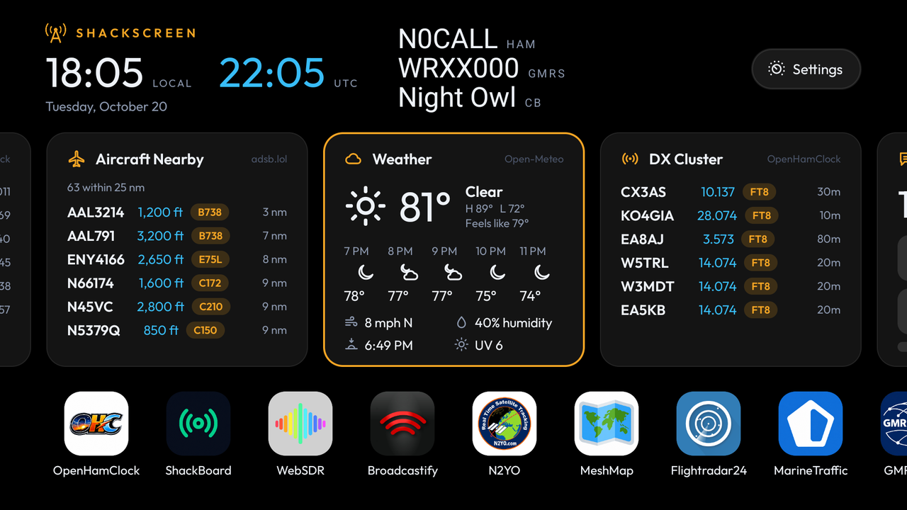

**Widgets**: Mesh Messages, Heard By SatNOGS, Satellite Passes


**Widget**: Weather


**Ocean theme with Dark icons**

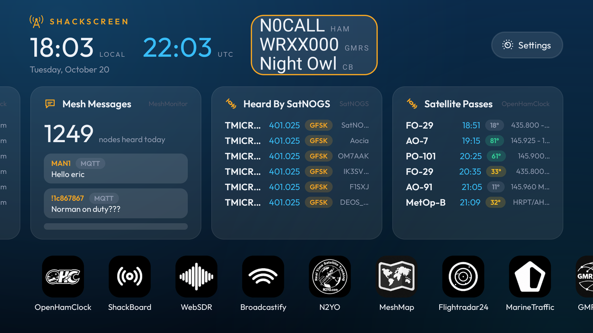

**Light theme with Light icons**


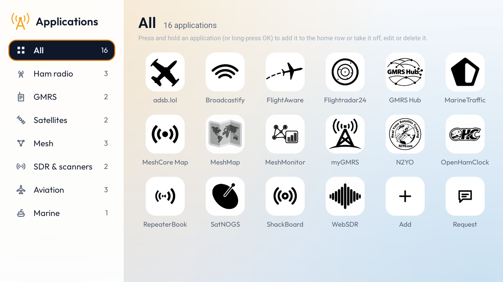

**Settings**: profiles, widgets, location, appearance, launcher and updates


---

## Quick Start (5-minute setup)

### 1) Download

Get `ShackScreen-<version>.apk` from [**Releases**](../../releases/latest).

---

### 2) Install it on the TV

- **Fire TV:** install the free *Downloader* app, allow it to install unknown apps, and open the APK's link.
- **Android TV / Google TV:** copy the APK with a file-transfer app (e.g. *Send files to TV*) and open it, or from a computer:

```sh
adb connect <tv-ip>
adb install ShackScreen-<version>.apk
```

---

### 3) Open ShackScreen

Space weather and POTA spots show up straight away, from the public OpenHamClock.

---

### 4) Set your location

**Settings → Location → Pick on a map**: the arrows move the map under the crosshair and **OK** sets it. **Menu** zooms, finds a place by name, or changes the map style. On a tablet, drag and tap. Or type a grid square (`FN31pr`) or latitude, longitude (`40.7, -74.0`).  
Needed for Aircraft Nearby, Satellite Passes and Weather.

**Map styles**: Dark (default), OpenStreetMap, Streets, OpenTopoMap, Humanitarian and Satellite, all free. You can also use **your own API key** for CARTO, Google Maps (Map Tiles API), Mapbox, MapTiler, Thunderforest or Stadia Maps (**Add a map with your API key**), or any tile server by its `{z}/{x}/{y}` address (**Add a custom map**). Keys are encrypted and stay on the device.

---

### 5) Add your profile (optional)

ShackScreen starts with the **Demo** profile (N0CALL, WRXX000, Night Owl). Select the call signs next to the clock (or **Settings → Profiles**), then **Add profile** with your **ham call sign**, **GMRS call sign** and **CB handle**. Add as many profiles as you like, one for each operator in the shack, and switch between them from the same place. They stay on the device.

---

### 6) Add your own servers (optional)

**All applications → Add app**: pick an app, then **My own server** and type its IP. The default port is added for you.

---

## Widgets

Pick them in **Settings → Widgets**. Press and hold a widget to **move** or **remove** it; select it to open the app its data comes from. Three fit across a TV, two on a portrait tablet, one on a phone. When nobody touches the remote for a minute, the dashboard pages through the rest on its own.

### Ham radio

| Widget | Data from |
|---|---|
| Space weather: SFI, sunspots, K and A index, X-ray, HF band conditions | [OpenHamClock](https://github.com/accius/openhamclock) or [ShackBoard](https://shackboard.com) |
| POTA spots | [OpenHamClock](https://github.com/accius/openhamclock) or [ShackBoard](https://shackboard.com) |
| DX cluster spots | [OpenHamClock](https://github.com/accius/openhamclock) |
| Contests, on now and coming up | [OpenHamClock](https://github.com/accius/openhamclock) |
| DXpeditions on the air | [OpenHamClock](https://github.com/accius/openhamclock) |

### Satellites

| Widget | Data from |
|---|---|
| Satellite passes over you: time, max elevation, downlink | [OpenHamClock](https://github.com/accius/openhamclock)'s orbital data, predicted on the device |
| Satellites just heard, with frequency and mode | [SatNOGS](https://github.com/satnogs) |

### Mesh (via MeshMonitor)

| Widget | Data from |
|---|---|
| Mesh sources: Meshtastic, MeshCore, MQTT, connected or not | [MeshMonitor](https://github.com/Yeraze/meshmonitor) |
| Mesh nodes heard today | [MeshMonitor](https://github.com/Yeraze/meshmonitor) |
| Mesh messages | [MeshMonitor](https://github.com/Yeraze/meshmonitor) |

In MeshMonitor's settings, create an API token and paste it into the MeshMonitor app in ShackScreen. The token acts as your user, so it only sees what you can see.

### Aviation and marine

| Widget | Data from |
|---|---|
| Aircraft within 25 nm | **your own** [tar1090](https://github.com/wiedehopf/tar1090) / [readsb](https://github.com/wiedehopf/readsb) / [dump1090](https://github.com/flightaware/dump1090), or [ADSB.lol](https://github.com/adsblol), [adsb.fi](https://github.com/adsbfi) |
| Ships nearby | **your own** [AIS-catcher](https://github.com/jvde-github/AIS-catcher) |

### Local

| Widget | Data from |
|---|---|
| Weather | [Open-Meteo](https://github.com/open-meteo/open-meteo) |

Each widget uses the first of your applications that can supply it, and moves on to the next if a server is down.

---

## Applications

The home row holds your favourites, with **All applications** at the end. Press and hold an app (long-press OK on a remote) to move it, add it to the home row or take it off, edit it or delete it.

<!-- apps -->
**Ham radio**

<table>
<tr><td align="center" width="110"><a href="https://github.com/accius/openhamclock">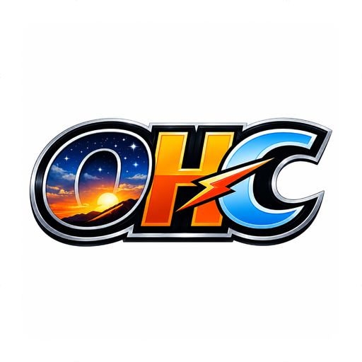</a><br/><sub><a href="https://github.com/accius/openhamclock">OpenHamClock</a></sub></td><td align="center" width="110"><a href="https://shackboard.com">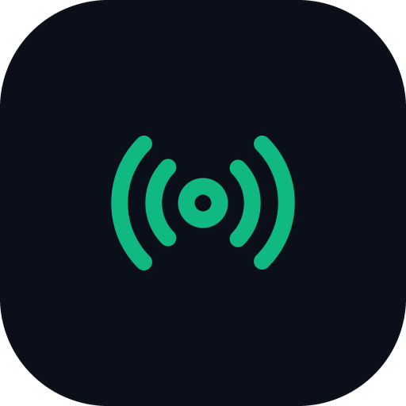</a><br/><sub><a href="https://shackboard.com">ShackBoard</a></sub></td><td align="center" width="110"><a href="https://aprs.fi"></a><br/><sub><a href="https://aprs.fi">APRS.fi</a></sub></td><td align="center" width="110"><a href="https://pskreporter.info/pskmap.html">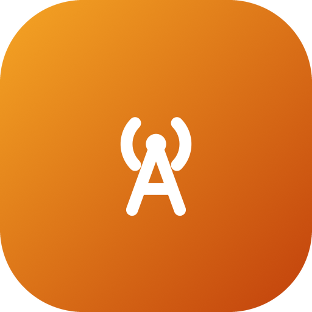</a><br/><sub><a href="https://pskreporter.info/pskmap.html">PSKReporter</a></sub></td><td align="center" width="110"><a href="https://www.repeaterbook.com/">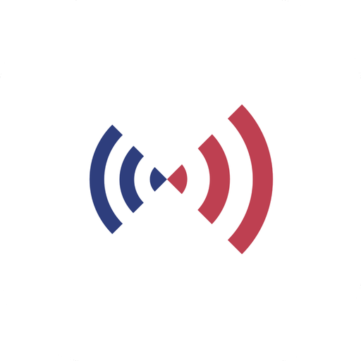</a><br/><sub><a href="https://www.repeaterbook.com/">RepeaterBook</a></sub></td><td align="center" width="110"><a href="https://pota.app/"></a><br/><sub><a href="https://pota.app/">POTA</a></sub></td></tr>
<tr><td align="center" width="110"><a href="https://www.clearskyinstitute.com/ham/HamClock/"></a><br/><sub><a href="https://www.clearskyinstitute.com/ham/HamClock/">HamClock (your own)</a></sub></td><td align="center" width="110"><a href="https://www.dxsummit.fi/"></a><br/><sub><a href="https://www.dxsummit.fi/">DX Summit</a></sub></td><td align="center" width="110"><a href="https://www.reversebeacon.net/main.php"></a><br/><sub><a href="https://www.reversebeacon.net/main.php">Reverse Beacon Network</a></sub></td><td align="center" width="110"><a href="https://wspr.rocks/"></a><br/><sub><a href="https://wspr.rocks/">WSPR Rocks</a></sub></td><td align="center" width="110"><a href="https://prop.kc2g.com/"></a><br/><sub><a href="https://prop.kc2g.com/">KC2G Propagation</a></sub></td><td align="center" width="110"><a href="https://sotl.as/"></a><br/><sub><a href="https://sotl.as/">SOTA (SOTLAS)</a></sub></td></tr>
</table>

**GMRS**

<table>
<tr><td align="center" width="110"><a href="https://gmrshub.com/access/home.php"></a><br/><sub><a href="https://gmrshub.com/access/home.php">GMRS Hub</a></sub></td><td align="center" width="110"><a href="https://mygmrs.com/">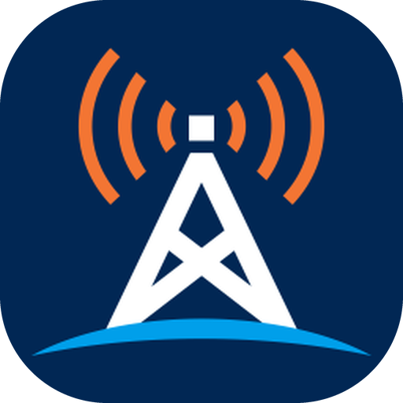</a><br/><sub><a href="https://mygmrs.com/">myGMRS</a></sub></td></tr>
</table>

**Satellites**

<table>
<tr><td align="center" width="110"><a href="https://www.n2yo.com">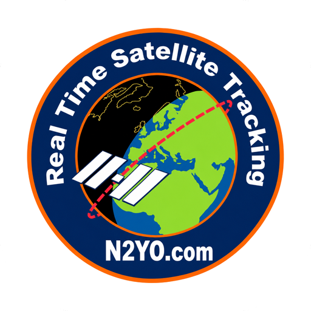</a><br/><sub><a href="https://www.n2yo.com">N2YO</a></sub></td><td align="center" width="110"><a href="https://www.heavens-above.com"></a><br/><sub><a href="https://www.heavens-above.com">Heavens-Above</a></sub></td><td align="center" width="110"><a href="https://www.amsat.org/status/"></a><br/><sub><a href="https://www.amsat.org/status/">AMSAT status</a></sub></td><td align="center" width="110"><a href="https://github.com/satnogs">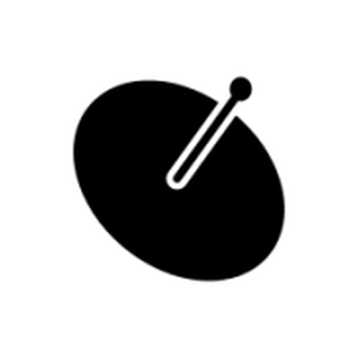</a><br/><sub><a href="https://github.com/satnogs">SatNOGS</a></sub></td><td align="center" width="110"><a href="https://github.com/tinygs/tinyGS">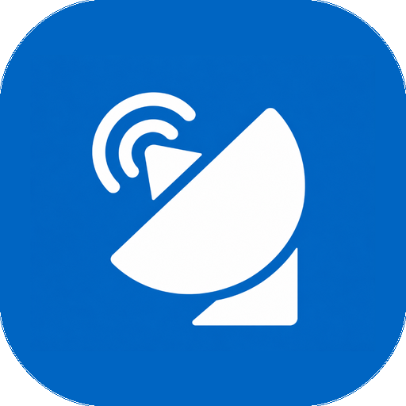</a><br/><sub><a href="https://github.com/tinygs/tinyGS">TinyGS</a></sub></td><td align="center" width="110"><a href="https://satellitemap.space"></a><br/><sub><a href="https://satellitemap.space">Satellite map</a></sub></td></tr>
<tr><td align="center" width="110"><a href="https://isstracker.pl/en">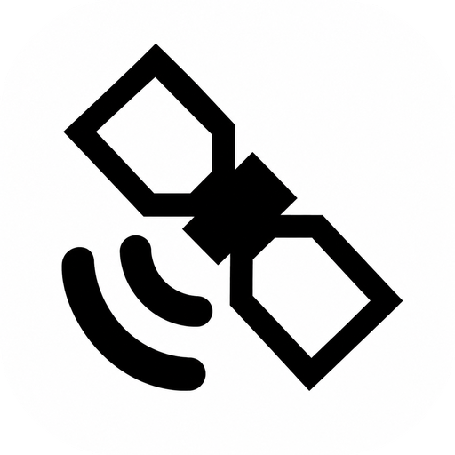</a><br/><sub><a href="https://isstracker.pl/en">ISS Tracker</a></sub></td></tr>
</table>

**Mesh**

<table>
<tr><td align="center" width="110"><a href="https://github.com/Yeraze/meshmonitor">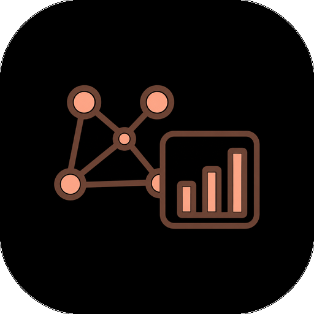</a><br/><sub><a href="https://github.com/Yeraze/meshmonitor">MeshMonitor</a></sub></td><td align="center" width="110"><a href="https://github.com/brianshea2/meshmap.net">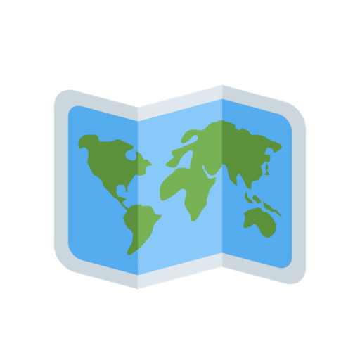</a><br/><sub><a href="https://github.com/brianshea2/meshmap.net">MeshMap</a></sub></td><td align="center" width="110"><a href="https://github.com/meshcore-dev/map.meshcore.io">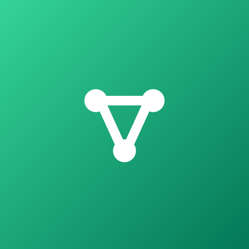</a><br/><sub><a href="https://github.com/meshcore-dev/map.meshcore.io">MeshCore Map</a></sub></td><td align="center" width="110"><a href="https://github.com/meshtastic/firmware"></a><br/><sub><a href="https://github.com/meshtastic/firmware">Meshtastic node</a></sub></td></tr>
</table>

**SDR & scanners**

<table>
<tr><td align="center" width="110"><a href="http://websdr.org/">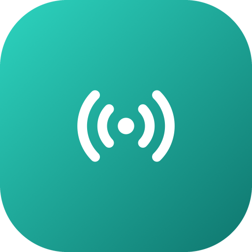</a><br/><sub><a href="http://websdr.org/">WebSDR</a></sub></td><td align="center" width="110"><a href="http://rx.linkfanel.net"></a><br/><sub><a href="http://rx.linkfanel.net">KiwiSDR map</a></sub></td><td align="center" width="110"><a href="https://www.broadcastify.com/listen/"></a><br/><sub><a href="https://www.broadcastify.com/listen/">Broadcastify</a></sub></td></tr>
</table>

**Aviation**

<table>
<tr><td align="center" width="110"><a href="https://www.flightradar24.com">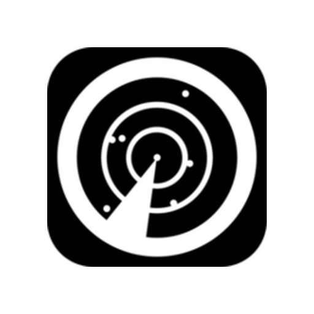</a><br/><sub><a href="https://www.flightradar24.com">Flightradar24</a></sub></td><td align="center" width="110"><a href="https://www.flightaware.com/live/map"></a><br/><sub><a href="https://www.flightaware.com/live/map">FlightAware</a></sub></td><td align="center" width="110"><a href="https://globe.adsbexchange.com">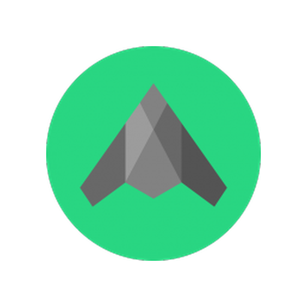</a><br/><sub><a href="https://globe.adsbexchange.com">ADS-B Exchange</a></sub></td><td align="center" width="110"><a href="https://github.com/adsblol"></a><br/><sub><a href="https://github.com/adsblol">adsb.lol</a></sub></td><td align="center" width="110"><a href="https://github.com/adsbfi"></a><br/><sub><a href="https://github.com/adsbfi">adsb.fi</a></sub></td><td align="center" width="110"><a href="https://github.com/wiedehopf/tar1090"></a><br/><sub><a href="https://github.com/wiedehopf/tar1090">My ADS-B receiver (tar1090)</a></sub></td></tr>
</table>

**Marine**

<table>
<tr><td align="center" width="110"><a href="https://www.marinetraffic.com/en/ais/home">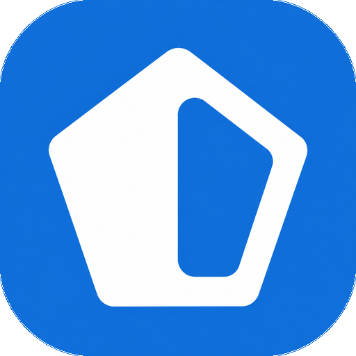</a><br/><sub><a href="https://www.marinetraffic.com/en/ais/home">MarineTraffic</a></sub></td><td align="center" width="110"><a href="https://www.vesselfinder.com">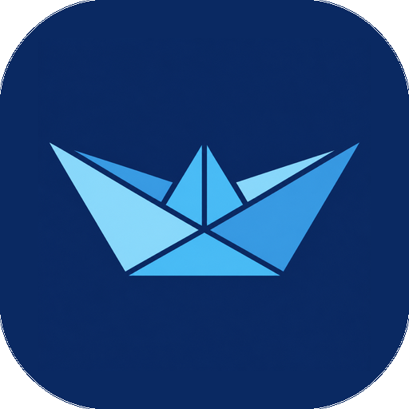</a><br/><sub><a href="https://www.vesselfinder.com">VesselFinder</a></sub></td><td align="center" width="110"><a href="https://www.myshiptracking.com">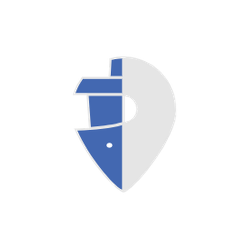</a><br/><sub><a href="https://www.myshiptracking.com">MyShipTracking</a></sub></td><td align="center" width="110"><a href="https://github.com/jvde-github/AIS-catcher"></a><br/><sub><a href="https://github.com/jvde-github/AIS-catcher">My AIS receiver (AIS-catcher)</a></sub></td></tr>
</table>

**Weather**

<table>
<tr><td align="center" width="110"><a href="https://www.windy.com"></a><br/><sub><a href="https://www.windy.com">Windy</a></sub></td><td align="center" width="110"><a href="https://map.blitzortung.org">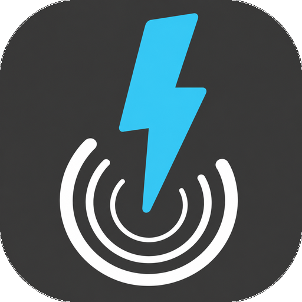</a><br/><sub><a href="https://map.blitzortung.org">Lightning map</a></sub></td><td align="center" width="110"><a href="https://www.swpc.noaa.gov/"></a><br/><sub><a href="https://www.swpc.noaa.gov/">NOAA Space Weather</a></sub></td></tr>
</table>

**Other**

<table>
<tr><td align="center" width="110"><br/><sub>Other web page</sub></td></tr>
</table>

Names starting with "My" or "your own" are for your own server or device. Applications without their own icon yet show the generic one.
<!-- /apps -->

### Pages inside an application

Some applications have several pages. **GMRS Hub** opens on its home page; **Menu** on the remote (or the **Pages** button on a tablet) switches to the Live Node Map, Hub Status, Groups and Get On GMRS Hub.

You can add your own pages to any application, such as more hub URLs or a hub status page for your own nodes: press and hold it, **Edit**, then **Your pages for this application**. To have a page as its own icon instead, add the application again with that address.

### Page size

Each application has its own page size, from 50% to 150%, so a site laid out large fits more on the TV. GMRS Hub starts at 80%. Change it with **Menu → Page size**, or in the application's settings.

### Saved logins

When you sign in to a site inside ShackScreen, it offers to save the login, like a password manager. Next time it fills it in and signs in for you.

- Kept for each **profile**: switching profile switches the saved logins, and the Demo profile has none of yours.
- Saved **encrypted** (AES-256-GCM) with a key kept in the Android Keystore, which never leaves it. Nothing is sent anywhere, except inside an encrypted [backup](#backup) if you set one up.
- Filled in **only on the site it was saved for**.
- If a saved login doesn't work, ShackScreen fills it in but stops pressing the sign-in button, so a wrong password isn't sent over and over.
- Add, change or delete logins, or turn off signing in automatically: press and hold the application, **Edit**, then **Saved logins**.
- Needs Android 6 or later.

### Public site or your own server

- Applications you can also run yourself (**[OpenHamClock](https://github.com/accius/openhamclock), [WebSDR](http://websdr.org), [KiwiSDR](https://github.com/jks-prv/Beagle_SDR_GPS)**) ask **Public site or My own server** when you add them.
- **[MeshMonitor](https://github.com/Yeraze/meshmonitor), [tar1090](https://github.com/wiedehopf/tar1090), [AIS-catcher](https://github.com/jvde-github/AIS-catcher)** and a **[Meshtastic node](https://github.com/meshtastic/firmware)** are always your own server.
- Type just the IP and the default port is added. You can add the same app more than once (say, the public OpenHamClock and the one on your shack Pi).
- Addresses and tokens are stored **only on the device**.

### Remote access (VPN)

To reach servers at home from a TV somewhere else, use a VPN such as [Tailscale](https://github.com/tailscale/tailscale): no port forwarding, encrypted, works behind NAT.

### Missing an app?

**All applications → Request an app…** opens an [app request](../../issues/new?template=app_request.yml) here. On a TV, scan the QR code with your phone. The app list lives in [`catalog.json`](app/src/main/assets/catalog.json) and refreshes from this repo, so new applications arrive without a new APK.

---

## Themes and Icons

- **Settings → Appearance**: Black (default), Midnight, Ocean, Forest, Plum, Ember, Slate, Light, or follow the TV.
- Every application shows its **own icon**, fetched from the server you point it at and made square like a phone app icon. A site without a good one gets a coloured tile for its category.
- **Settings → Appearance → Application icons**: Colour, Dark, Light, or match the theme. The style that suits your theme is marked *suggested*: Colour on Black, Dark on the tinted themes (Midnight, Ocean, Forest, Plum, Ember, Slate), Light on Light.
- ShackScreen's own icon set lives in [`icons/`](icons) (512 × 512 PNG, in colour, dark and light). The app loads it from this repo, so new icons arrive without an update. **Want to design one?** See [Contributing Icons](docs/ICONS.md).
- **All applications** lists them by category, with a count for each, like a TV channel guide.
- To change an icon: press and hold the application, **Edit**, then **Icon**. Choose a symbol, an image from a web address, or an image on the device (tablets and TVs with a file picker).
- Have a better icon for everyone? **Icon → Suggest a new icon on GitHub** opens an [icon request](../../issues/new?template=icon_request.yml); on a TV, scan the QR code with your phone.

---

## Remote and Touch

| | Remote | Touch |
|---|---|---|
| Open an app or widget | **OK** | tap |
| Choose what a widget opens | hold **OK** → **Opens** | press and hold → **Opens** |
| Move, remove, edit | hold **OK** | press and hold |
| Move a widget | arrows, then **OK** | on-screen arrows, then tap |
| Back a page / home | **Back** | back |
| Pages, page size, reload | **Menu** | Pages button |

An app that can't be reached is retried every 30 seconds, and the screen stays on while one is open.

---

## Launcher Mode

ShackScreen is a launcher dashboard: it can also be the device's home screen. This is **off by default**.

**Settings → Launcher → Use ShackScreen as a launcher**:

- Android's **Default home app** choice opens; pick ShackScreen. **Home** on the remote then opens the dashboard, and **Back** stays on it.
- **All applications** gets an **Android apps** category: every installed app, plus **Android settings**. Press and hold an app to add it to the home row next to your radio applications.
- **Home screen** shows which launcher is in charge, and switches back to the TV's own.
- Turning launcher mode off returns to the TV's own home screen.

Some devices (Fire TV, newer Google TV) don't let you change the home screen; the Android apps list still works there.

---

## Backup

**Settings → Backup** keeps an encrypted copy of your setup on a cloud service, a server on your own network or a USB drive, and puts it back on a new or reset TV.

- **What's in it:** your profiles and each profile's saved logins, your applications (with their addresses and tokens), widgets, location, theme, map keys and custom icons.
- **Encrypted on the TV** with a passphrase you choose (PBKDF2, then AES-256-GCM), before it's sent. The service only stores a file it can't read. Write the passphrase down: nobody can recover it, and you need it to restore.
- **Services:**

| Service | How you connect |
|---|---|
| **Google Drive** | Scan a QR code with your phone and enter the code shown on the TV. Saved in a ShackScreen folder; ShackScreen can only see its own files. |
| **Dropbox** | Scan a QR code, allow ShackScreen, then type the code Dropbox shows. Saved in Apps/ShackScreen. |
| **S3-compatible** | AWS S3, Backblaze B2, Cloudflare R2 or MinIO: an endpoint, bucket and access key. Use a key that can only reach that bucket. |
| **WebDAV** | Nextcloud, Synology, ownCloud or any WebDAV server: a folder address, user name and password. |
| **USB drive** | **Save a backup to a USB drive** and **Restore from a USB drive**: no account and no network. Where the device has a file picker you choose the folder; otherwise it goes in `Android/data/com.maxhayim.shackscreen/files/ShackScreen` on the drive. |

- **No internet needed:** a USB drive, or a WebDAV or MinIO server on your home network (a Synology, a Nextcloud box, a Raspberry Pi), keeps everything inside your network. Plain `http://192.168.x.x` addresses work. Together with self-hosted applications (MeshMonitor, OpenHamClock, tar1090, AIS-catcher), ShackScreen can run entirely offline from the internet.
- USB backups are saved with the date in the name, so older ones are kept. Copy them somewhere safe: Android deletes ShackScreen's folder on the drive if the app is uninstalled while the drive is plugged in.

- **Back up every day** is on once a service and passphrase are set. **Back up now** does it straight away.
- **Restore from backup:** choose the same service, enter the passphrase, and confirm. It replaces what's on the TV, then reopens the dashboard.
- **Sync with other TVs:** turn it on in Settings → Backup on each TV, with the same service and passphrase. Profiles, saved logins, applications (with their tokens), map keys and the location then stay the same everywhere: a change on one TV reaches the others when Settings closes or within 15 minutes. Each TV keeps its own theme, icon style, widgets, launcher mode and the profile in use. Changes merge item by item; if the same thing changed on two TVs, the later change wins, and a deletion on one TV deletes it everywhere. A TV joining for the first time takes what the others have and adds anything only it has. It uses its own encrypted file on the service (`shackscreen-sync.ssb`), so your backup is untouched, and it works over a home-network WebDAV or MinIO server without the internet.
- Sign-ins to the service, and the passphrase, are kept encrypted on the TV only. **Stop backing up** forgets them; the backup stays on the service.
- Needs Android 6 or later.

---

## Updates

**Settings → Updates**:

- **Off** — never contacts GitHub
- **Tell me** (default) — checks GitHub Releases daily and shows an *Update* button
- **Install automatically** — downloads and installs new versions. Silent on Android 12+ once ShackScreen has updated itself once; one confirm click on older Android and Fire TV.

An update is installed only if it's ShackScreen, newer, and **signed with the same key**:

`a4b212f1b47635da599640c4c61d431b98671833b67f36b97df3a748ef5e8a32` (SHA-256)

---

## Requirements

- Android TV, Google TV or Fire TV with Android 5.1 or newer (or an Android tablet or phone)
- Internet
- Your own servers and SDR receivers: optional

No Google account.  
No root.  
No subscriptions.

---

## Build from Source

Needs JDK 17 and the Android SDK (platform 35). Turn on developer options and network debugging on the TV, then:

```sh
TV_HOST=192.168.1.50 ./build-and-install.sh
```

Without `TV_HOST` it only builds `app/build/outputs/apk/release/app-release.apk`.

Google Drive and Dropbox backups need your own OAuth keys: see [docs/BACKUP-KEYS.md](docs/BACKUP-KEYS.md). Without them, the build offers S3 and WebDAV only.

---

## License

This project is licensed under the MIT License.

See the LICENSE file for details.  
Full license text: https://opensource.org/licenses/MIT

Application names and the logos in the application icons are trademarks of their respective owners, used only to identify each service (some resized, recoloured or simplified to fit the app); ShackScreen is not affiliated with or endorsed by them, and the MIT License doesn't cover them. See [TRADEMARKS.md](TRADEMARKS.md).

Includes the [Outfit](https://github.com/Outfitio/Outfit-Fonts) font (SIL Open Font License, included in the LICENSE file) and Project Nayuki's [QR Code generator](https://github.com/nayuki/QR-Code-generator) (MIT).

---

## Contributing

Pull requests are welcome. Open an issue first to discuss ideas or report bugs. See [CONTRIBUTING.md](CONTRIBUTING.md); adding an app to the menu is usually one entry in `catalog.json`.

---

## Acknowledgments

* Inspired by [CleanYourTV](https://github.com/Gathin23/cleanyourtv)
* [OpenHamClock](https://github.com/accius/openhamclock) by K0CJH
* [ShackBoard](https://shackboard.com)
* [MeshMonitor](https://github.com/Yeraze/meshmonitor) built by [Yeraze](https://github.com/Yeraze)
* [SatNOGS](https://github.com/satnogs) by the Libre Space Foundation
* [ADSB.lol](https://github.com/adsblol) and [adsb.fi](https://github.com/adsbfi) (ODbL)
* [AIS-catcher](https://github.com/jvde-github/AIS-catcher)
* [Open-Meteo](https://github.com/open-meteo/open-meteo)
