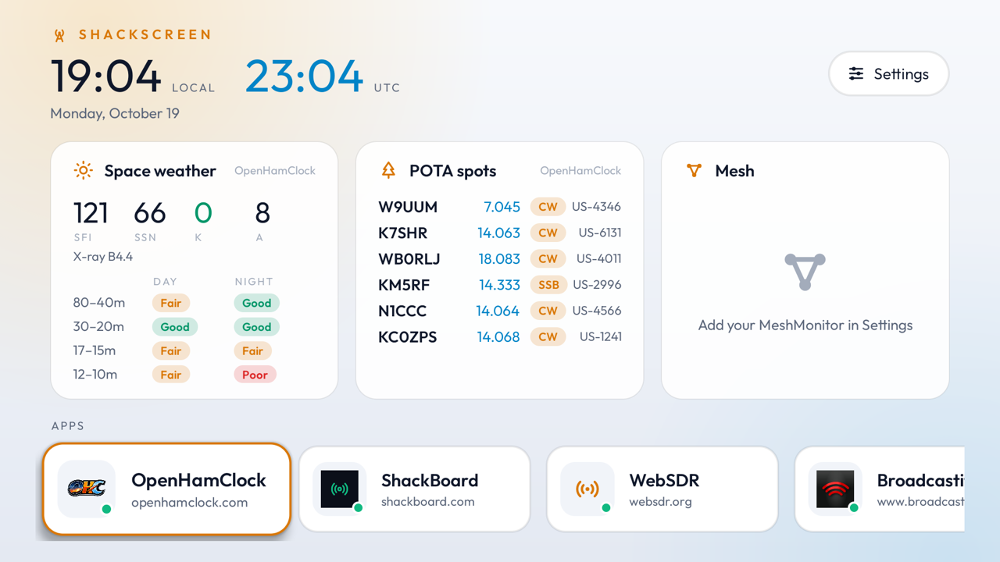

# ShackScreen

Radio dashboards on your TV. ShackScreen is a small Android TV / Google TV / Fire TV app for hams and
mesh users: a live dashboard on top, and a row of radio web apps you open full-screen with the remote.
Dark and light themes (or follow the TV), and each app tile shows the app's own icon, fetched from
whichever server you point it at.

| Dark | Light |
|---|---|
|  |  |

## What's on the dashboard

| Panel | Comes from |
|---|---|
| Space weather: SFI, sunspots, K/A index (coloured by storm level), X-ray, HF band conditions | OpenHamClock (`/api/n0nbh`) or ShackBoard (`/api/space-weather`) |
| Latest POTA spots | OpenHamClock (`/api/pota/spots`) or ShackBoard (`/api/spots`, POTA only) |
| Mesh: nodes heard today, latest messages | MeshMonitor (`/api/v1`, needs an API token) |

Each panel uses the first of your apps that can supply it and moves on to the next if a server is down.
Panels refresh every 2 minutes; the dot on each app tile shows whether its server is reachable.

## Apps

| App | Public site | Run your own |
|---|---|---|
| [OpenHamClock](https://github.com/accius/openhamclock) | openhamclock.com | yes, default port 3000 |
| [ShackBoard](https://shackboard.com) | shackboard.com | — |
| [MeshMonitor](https://github.com/Yeraze/meshmonitor) | — | yes, default port 8080 |
| [WebSDR](http://websdr.org) | websdr.org directory | point it at any receiver |
| [Broadcastify](https://www.broadcastify.com) | broadcastify.com | — |
| [RepeaterBook](https://www.repeaterbook.com) | repeaterbook.com | — |
| Other web page | — | any URL |

Every app can use the public site **or your own server**, and you can add the same app more than once
(say, public OpenHamClock and the one on your shack Pi). Type just the IP and the default port is added.
Addresses and tokens are stored only on the TV. The list of known apps lives in
[`app/src/main/assets/catalog.json`](app/src/main/assets/catalog.json).

### MeshMonitor token

In MeshMonitor's settings, create an API token and paste it into the MeshMonitor entry in
ShackScreen's settings. The token acts as your user, so it only sees what you can see.

## Remote

- **Left/Right/OK** on the dashboard: pick and open an app.
- **Back** in an app: go back a page, or return to the dashboard.
- **Menu**: reload the page.
- An app that can't be reached is retried every 30 seconds, and the screen stays on while one is open.

## Install

Download `ShackScreen-<version>.apk` from [Releases](../../releases/latest) and sideload it:

- **Fire TV:** install the free *Downloader* app, allow it to install unknown apps, and open the APK's link.
- **Android TV / Google TV:** copy the APK with a file-transfer app (e.g. *Send files to TV*) and open it,
  or from a computer: `adb connect <tv-ip>` then `adb install ShackScreen-<version>.apk`.

Releases are always signed with the same ShackScreen key, so a newer APK installs straight over the old one.
The key's SHA-256 is `a4b212f1b47635da599640c4c61d431b98671833b67f36b97df3a748ef5e8a32`.

## Updates

In ⚙ Settings → Updates:

- **Off**: never contacts GitHub.
- **Tell me** (default): checks GitHub Releases daily and shows an *Update* button on the dashboard.
- **Install automatically**: downloads and installs new versions. On Android 12+ this is silent once
  ShackScreen has installed one update itself; on older Android and Fire TV you confirm with one click.

An update is only installed if it's ShackScreen, newer, and signed with the same key. The list of apps
(`catalog.json`) also refreshes from this repo, so new apps can appear without a new APK. Your own
servers and tokens are never sent anywhere.

## Build from source

Needs JDK 17 and the Android SDK (platform 35). Turn on developer options and network debugging on the TV, then:

```sh
TV_HOST=192.168.1.50 ./build-and-install.sh
```

Without `TV_HOST` it only builds `app/build/outputs/apk/release/app-release.apk`.

## License

MIT
