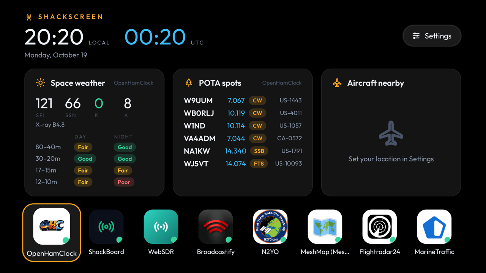

# ShackScreen

Radio dashboards on your TV, for people who love frequencies. ShackScreen is a small Android TV / Google TV /
Fire TV app (it runs on tablets too) for hams, mesh, satellite, aviation and marine radio fans: a live dashboard on top, and a row of radio web apps you open full-screen with the remote.
A black background by default, or pick a colour (Midnight, Ocean, Forest, Plum, Ember, Slate) or Light.
Apps sit on a home row as phone-style icons, each showing the app's own icon fetched from whichever
server you point it at; **All apps** lists everything by category.

| Home | All apps |
|---|---|
|  |  |

## Widgets

Pick the widgets you want in **Settings → Widgets**, and arrange them on the dashboard: select one and press
OK (or long-press it on a tablet), move it with the arrows, then press OK again. Three fit across a TV,
two on a portrait tablet, one on a phone; the rest scroll, and when nobody touches the remote for a minute
the dashboard pages through them on its own.

| Widget | Comes from |
|---|---|
| Space weather: SFI, sunspots, K/A index, X-ray, HF band conditions | OpenHamClock or ShackBoard |
| POTA spots | OpenHamClock or ShackBoard |
| DX cluster spots | OpenHamClock |
| Contests on now and coming up | OpenHamClock |
| DXpeditions on the air | OpenHamClock |
| Satellite passes over you (time, max elevation, downlink) | OpenHamClock's orbital data, predicted on the TV |
| Satellites just heard, with frequency and mode | SatNOGS |
| Mesh sources (Meshtastic, MeshCore, MQTT), connected or not | MeshMonitor |
| Mesh nodes heard today | MeshMonitor |
| Mesh messages | MeshMonitor |
| Aircraft within 25 nm | adsb.lol, adsb.fi, or your own tar1090 / readsb / dump1090 |
| Ships nearby | your own AIS-catcher |
| Local weather | Open-Meteo |

Aircraft, satellite passes and weather need your location: a grid square (FN31pr) or latitude, longitude,
in **Settings → Location**. Each widget uses the first of your apps that can supply it and moves on to the
next if a server is down.

## Apps

The home row holds your favourites, with **All apps** at the end (it can be moved too); All apps has everything,
by category. Icons are each site's own, made square like phone app icons; a site without a good one gets a
coloured tile for its category. Press and hold an app (long-press
OK on a remote) to add it to the home row or take it off, move it, edit it or delete it. Press and hold a
widget to move it or remove it; selecting a widget opens the app its data comes from.

Apps by category:

| Category | Apps |
|---|---|
| Ham radio | OpenHamClock, ShackBoard, APRS.fi, PSKReporter, RepeaterBook |
| Satellites | N2YO, Heavens-Above, AMSAT status, SatNOGS, TinyGS, Satellite map, ISS Tracker |
| Mesh | MeshMonitor, MeshMap (Meshtastic), MeshCore Map, your Meshtastic node |
| SDR & scanners | WebSDR, KiwiSDR map, Broadcastify |
| Aviation | Flightradar24, FlightAware, ADS-B Exchange, adsb.lol, adsb.fi, your tar1090 |
| Marine | MarineTraffic, VesselFinder, MyShipTracking, your AIS-catcher |
| Weather | Windy, Lightning map |
| Other | any web page |

Apps you can also run yourself (OpenHamClock, WebSDR, KiwiSDR) ask **Public site or My own server** when you
add them; MeshMonitor, tar1090, AIS-catcher and a Meshtastic node are your own server. You can add the same
app more than once.
Type just the IP and the default port is added. Addresses and tokens are stored only on the device. The
list of apps lives in [`app/src/main/assets/catalog.json`](app/src/main/assets/catalog.json) and refreshes
from this repo, so new apps can appear without a new APK.

Missing one? **+ Add app → Request an app…** (or the button in *Other web page*) opens an
[app request](../../issues/new?template=app_request.yml) here; on a TV, scan the QR code with your phone.

### MeshMonitor token

In MeshMonitor's settings, create an API token and paste it into the MeshMonitor entry in
ShackScreen's settings. The token acts as your user, so it only sees what you can see.

## Remote and touch

- **Left/Right/OK** on the dashboard: pick and open an app. On a tablet, tap.
- **OK on a widget** (or long-press): pick it up to move it.
- **Back** in an app: go back a page, or return to the dashboard.
- **Menu**: reload the page.
- An app that can't be reached is retried every 30 seconds, and the screen stays on while one is open.

## Install

Download `ShackScreen-<version>.apk` from [Releases](../../releases/latest) and sideload it:

- **Fire TV:** install the free *Downloader* app, allow it to install unknown apps, and open the APK's link.
- **Android TV / Google TV:** copy the APK with a file-transfer app (e.g. *Send files to TV*) and open it,
  or from a computer: `adb connect <tv-ip>` then `adb install ShackScreen-<version>.apk`.

Releases are always signed with the same ShackScreen key, so a newer APK installs straight over the old one.
The key's SHA-256 is `a4b212f1b47635da599640c4c61d431b98671833b67f36b97df3a748ef5e8a32`.

## Updates

In ⚙ Settings → Updates:

- **Off**: never contacts GitHub.
- **Tell me** (default): checks GitHub Releases daily and shows an *Update* button on the dashboard.
- **Install automatically**: downloads and installs new versions. On Android 12+ this is silent once
  ShackScreen has installed one update itself; on older Android and Fire TV you confirm with one click.

An update is only installed if it's ShackScreen, newer, and signed with the same key. The list of apps
(`catalog.json`) also refreshes from this repo, so new apps can appear without a new APK. Your own
servers and tokens are never sent anywhere.

## Build from source

Needs JDK 17 and the Android SDK (platform 35). Turn on developer options and network debugging on the TV, then:

```sh
TV_HOST=192.168.1.50 ./build-and-install.sh
```

Without `TV_HOST` it only builds `app/build/outputs/apk/release/app-release.apk`.

## License

MIT. Includes the [Outfit](https://github.com/Outfitio/Outfit-Fonts) font (SIL Open Font License, see
`FONT-LICENSE-OFL.txt`) and Project Nayuki's [QR Code generator](https://github.com/nayuki/QR-Code-generator)
(MIT, in `app/src/main/java/io/nayuki`).

Data comes from the apps you add and from adsb.lol and adsb.fi (ODbL), Open-Meteo, and the SatNOGS network.
